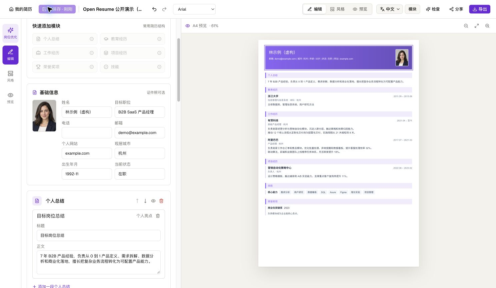
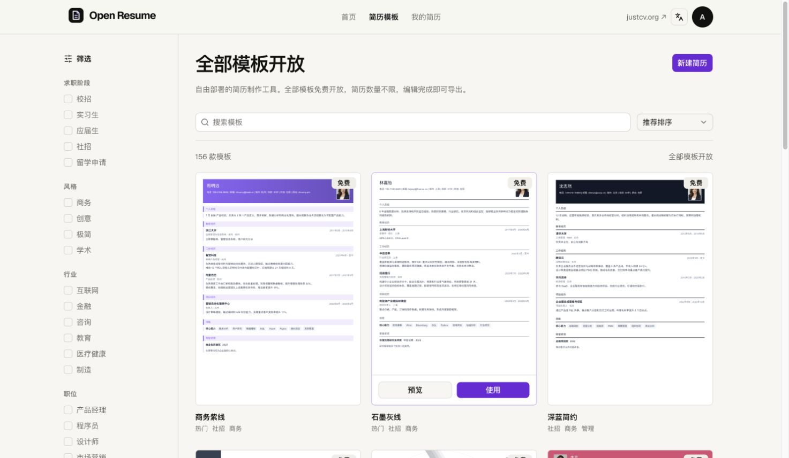
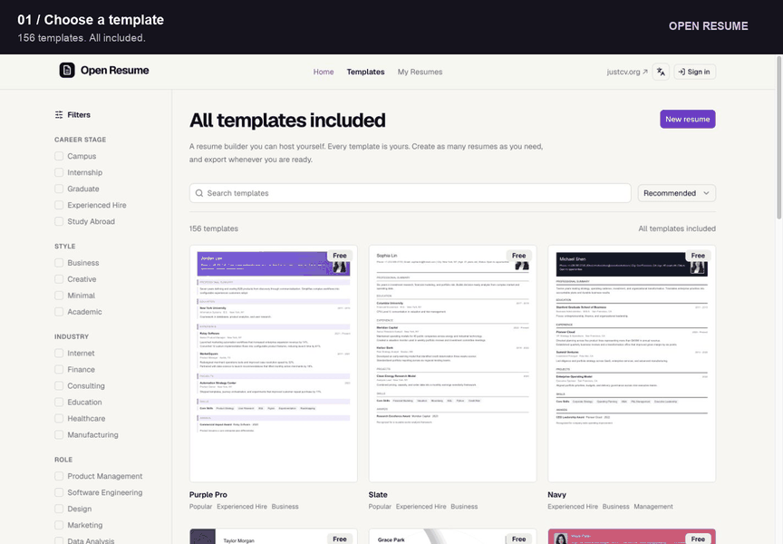

<p align="center">
  
</p>

<h1 align="center">Open Resume</h1>

<p align="center">An open-source resume builder. All templates. Free exports. Your own data.</p>

<p align="center">
  English · <a href="README.zh-CN.md">简体中文</a><br>
  <a href="#getting-started">Self-host</a> · <a href="#features">Features</a> · <a href="#demo">Demo</a> · <a href="https://justcv.org">Hosted version</a> · <a href="LICENSE">MIT License</a>
</p>

**Don't pay for features you rarely use.** A resume is something you update when you need it. Open Resume is free and open source: use every template, create as many resumes as you like, and export without a paywall or watermark. Run it yourself and keep your data under your control.

**Prefer to skip deployment?** Use the **[paid hosted version at justcv.org](https://justcv.org)** and support continued development. Choose the convenience of hosting when you need it; self-host the open-source project whenever you like.



## Features

- **156 templates, all included** — browse, filter, preview, and switch layouts without unlocking a plan.
- **An editor that stays out of your way** — live A4 preview, autosave, undo/redo, photos, section ordering, fonts, and accent colors.
- **Unlimited resumes and free exports** — PDF, PNG, and JSON backups, without watermarks.
- **Find and organize your resumes** — search by title, name, or target role; sort by update time or title; rename and duplicate from your workspace.
- **Local resume checks** — review content, contact details, and date ranges, then jump to the relevant editor fields. Runs in the browser without an API key.
- **Version history** — automatic checkpoints, named snapshots of your current editor, content and appearance comparisons, and restoration as a new copy.
- **Import an existing resume** — read text PDFs, DOCX, TXT, Markdown, or pasted text on your device, review the result, and import a new resume. JSON backups restore content and appearance.
- **Local job matching** — compare a posting with visible resume content, add your own keywords, and jump to matching evidence. No API key needed.
- **Seven interface languages** — English, Simplified Chinese, Traditional Chinese, Japanese, Korean, French, and Russian.
- **Your own workspace** — local SQLite storage, server-side sessions, bundled fonts, and no analytics or telemetry.
- **Optional AI tailoring** — bring your own API key to adapt a copy to a job description. No application-level daily quota or cooldown; provider fees and limits still apply.
- **Easy to run and modify** — Docker or Node.js 24+, with a strict TypeScript frontend and server. No cloud database, OAuth, or payment setup required.



## Demo

Choose a template, edit your details, change the style, and export your resume.

[](https://github.com/AniChikage/open-resume/raw/refs/heads/main/docs/media/open-resume-demo.mp4)

**[Download the 30-second demo (MP4)](https://github.com/AniChikage/open-resume/raw/refs/heads/main/docs/media/open-resume-demo.mp4)** · [Text walkthrough](docs/media/README.md)

Screenshots and the walkthrough show the real app with fictional English sample data.

## Getting started

### Docker

```sh
git clone https://github.com/AniChikage/open-resume.git
cd open-resume
docker compose up -d --build
```

Open **[http://localhost:3000](http://localhost:3000)**. Sign in with **`admin` / `admin`**; the demo credentials are prefilled.

Data is stored in the `resumes` named volume and survives container replacement. Stop with `docker compose down`. Adding `-v` deletes the data volume.

### Node.js

Requires **Node.js 24 or later**.

```sh
git clone https://github.com/AniChikage/open-resume.git
cd open-resume
npm ci
npm run build
npm start
```

Open **[http://localhost:3000](http://localhost:3000)** and use **`admin` / `admin`**. For development, run `npm run dev` to start the local API and Vite hot reload on the same port.

## Your workspace and data

Each installation has **one shared workspace**. Everyone using the same login can access the same resumes. To replace the public demo credentials, copy `.env.example` to `.env`, set both values, and restart:

```dotenv
LOCAL_USERNAME=yourname
LOCAL_PASSWORD=your-own-password
```

Custom passwords are not displayed in the interface. Changing credentials invalidates old sessions. This version does not provide separate user accounts or tenant isolation.

Node mode stores data in `.data/open-resume.sqlite` by default; set `DATA_DIR` to use another directory. To back up, stop the app and copy the entire data directory, including any `-wal` and `-shm` files. In Docker, back up the named volume after stopping the service. Keep a backup before deleting data.

Version history is stored in the same SQLite database. Each resume keeps its initial version, 20 recent automatic versions, and 30 recent manual snapshots; automatic changes within one minute are grouped. Named snapshots can include current unsaved edits. Compare content and appearance before restoring a version as a new resume; the source stays intact.

Import reads files locally and asks you to review detected fields and editable source text before saving a new resume to your workspace. Original layouts, photos, and dates may need adjustment. Scanned PDFs and images have no built-in OCR; extract their text first or paste it manually.

Job matching keeps the posting and selected keywords in this browser for the current resume. It measures keyword coverage, not an ATS score or a hiring prediction. You can pass the posting into optional AI tailoring, which asks for consent before sending content to your configured provider.

Use `PORT` to change the port. The server and Compose port bind to loopback by default. Set `HOST=0.0.0.0` for LAN access; for a public deployment, use private credentials, an HTTPS reverse proxy, and `SECURE_COOKIE=true`.

Share links encode the resume in the URL fragment without third-party storage. Recipients must be able to reach your deployment; uploaded avatars are not included automatically. Share snapshots support up to 1 MiB of uncompressed content; export a PDF or JSON backup for larger resumes.

## Optional AI tailoring

Editing, saving, and exporting work without AI. To enable tailoring, configure a Chat Completions-compatible provider in `.env` and restart:

```dotenv
AI_API_KEY=your-own-key
AI_BASE_URL=https://openrouter.ai/api/v1
AI_MODEL=your-provider-model-id
```

Choose a model that supports `response_format: json_object`. Keep the key server-side; do not prefix it with `VITE_`. API usage is billed by your provider and no model credits are included.

Tailoring sends resume text and the job description only after you agree. Contact fields, photos, and hidden sections are excluded; remove any private details inside the body yourself. Review suggestions before saving a separate copy. The original resume stays intact; job descriptions and unaccepted suggestions are not stored in the database.

## Development

```sh
npm run dev          # Local API and frontend hot reload
npm run typecheck    # Strict TypeScript checks
npm test             # Isolated HTTP, persistence, and document tests
npm run build        # Type checking and production frontend
```

Node.js 24 runs the server's `.ts` files directly; Vite builds the browser code. Shared types are in `src/types.ts`; external JSON validation is in `src/lib/validation.ts`. GitHub Actions and Docker builds run the tests and type checks. AI tests use a synthetic provider and do not consume paid credits.

See the [verification record](docs/verification.md) and [Docker acceptance](docs/docker-acceptance.md) for tested behavior and current boundaries. Bug reports, documentation improvements, and focused pull requests are welcome in [Issues](https://github.com/AniChikage/open-resume/issues).

## License

[MIT](LICENSE) — use, modify, distribute, and build on it, including commercially. Third-party fonts and dependencies retain their own licenses; see [THIRD_PARTY_NOTICES.md](THIRD_PARTY_NOTICES.md).
